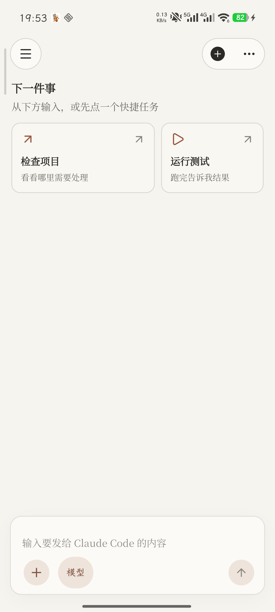
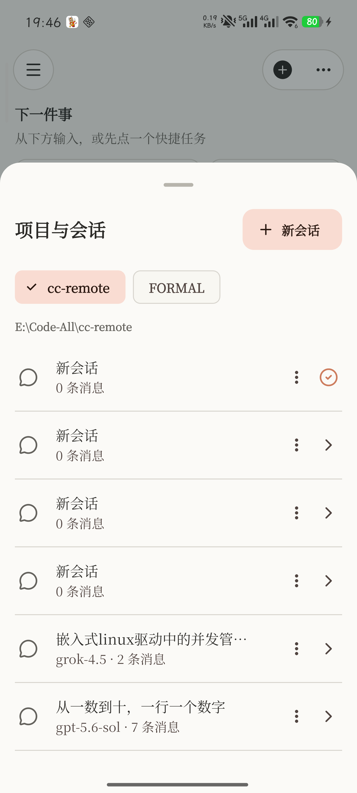
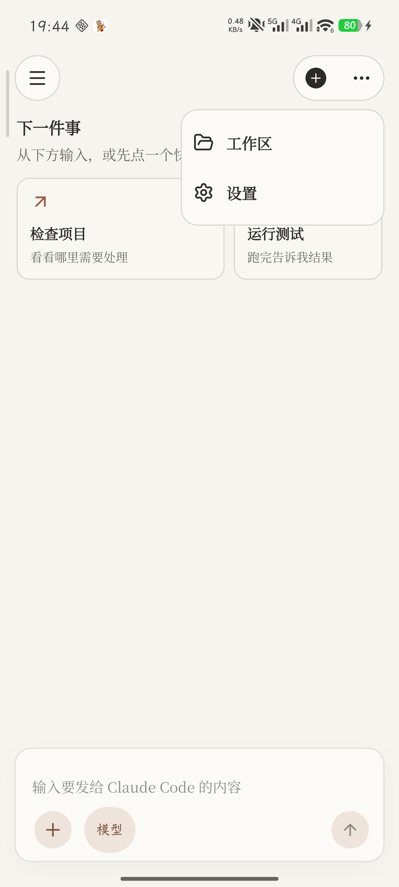
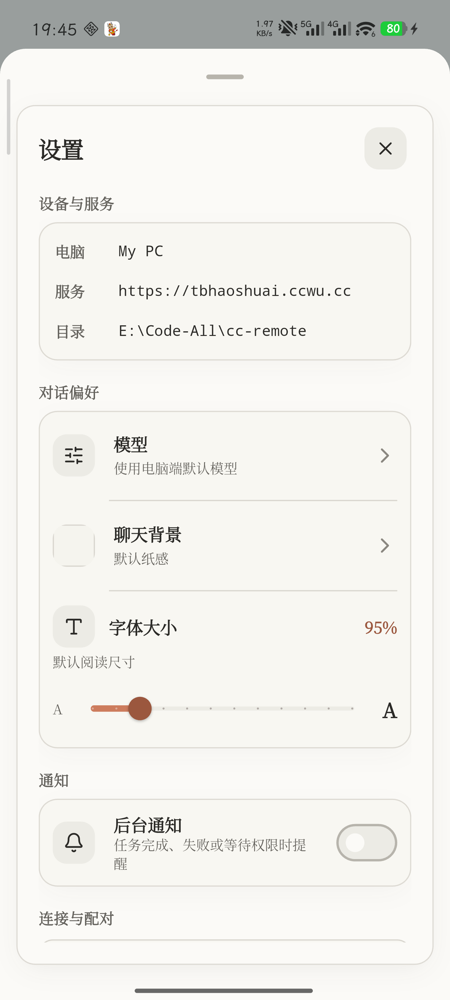
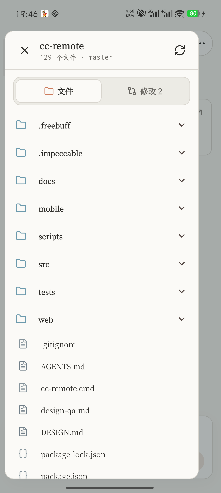
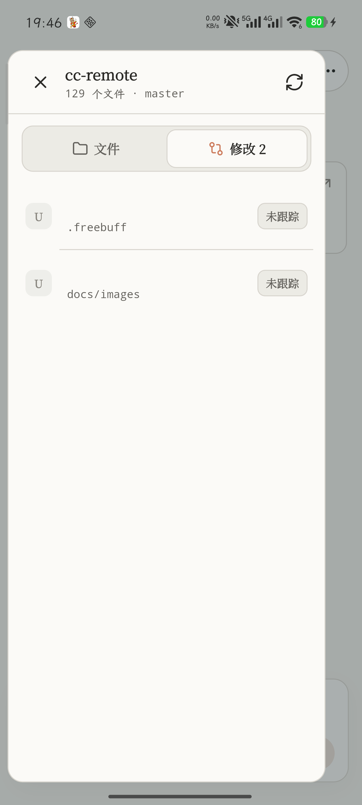

# CC Remote

**在手机上远程控制本机 Claude Code。**

扫码配对后，你就能在 Warm Console 里发指令、看流式回复、审批工具权限、浏览工作区与 Git 变更——电脑端 daemon 继续跑 Claude Code CLI，手机只是随身控制台。

[下载 Android APK · v1.2.0](https://github.com/TangBo-cpu/cc-remote/releases/download/v1.2.0/cc-remote-v1.2.0-android.apk)
·
[Release 说明](https://github.com/TangBo-cpu/cc-remote/releases/tag/v1.2.0)

```text
手机 App  ──HTTPS / WSS──▶  Cloudflare Tunnel  ──▶  本机 daemon (:8787)  ──▶  Claude Code CLI
```

<p align="center">
  
</p>

<p align="center"><sub>Warm Console · 已连接空状态：快捷任务 + 贴底 Composer</sub></p>

---

## 它能做什么

| 场景 | 体验 |
| --- | --- |
| 出门前丢一条任务 | 手机发 prompt，桌面 Claude 继续跑；流式回复实时回传 |
| 工具要权限 | 手机弹出决策卡：看命令摘要与工作目录，拒绝或仅本次允许 |
| 想确认改了什么 | 只读工作区 + Git diff，手机不提交、不改文件 |
| 断线了 | transcript 与草稿保留，自动重连；回来后从权威快照继续 |
| 字号不合适 | 设置里连续滑杆，默认约 95% |

**安全边界（产品承诺）：**

- daemon 默认只听 `127.0.0.1`，公网走 Tunnel
- 一次性扫码配对，Bearer token；退出配对即撤销
- 手机不能注册任意目录、不能跑任意 shell、不能远程编辑 / 提交

---

## 界面一览

真机截图（v1.2.0 Warm Console）。

| 主控制台 | 项目与会话 | 更多菜单 |
| :---: | :---: | :---: |
|  |  |  |

| 设置（字号滑杆） | 工作区文件 | Git 修改 |
| :---: | :---: | :---: |
|  |  |  |

暖白纸感背景、衬线阅读正文、更宽助手气泡、`terracotta-deep` 发送按钮；顶部只有圆形菜单 + 新建/更多胶囊，模型放在 Composer。设计规格见 [`DESIGN.md`](DESIGN.md)。

---

## 三分钟上手

### 1. 电脑端

在要交给 Claude 的项目目录：

```powershell
cc-remote
```

会启动 daemon + Cloudflare Tunnel，并在终端打印**手机配对二维码**。`Ctrl+C` 结束本次服务。

daemon 已在跑时，换目录再执行一次 `cc-remote`，只注册并切换项目，不重复起服务。

### 2. 手机端

1. 安装 [v1.2.0 APK](https://github.com/TangBo-cpu/cc-remote/releases/download/v1.2.0/cc-remote-v1.2.0-android.apk)（测试签名，个人使用）
2. 允许「未知来源」安装
3. 打开 App → 扫终端二维码 → 确认电脑名与服务地址 → 进入控制台

### 3. 开始对话

在 Composer 输入任务，或点空状态快捷芯片。运行中可随时停止；需要权限时在手机上点一次「仅本次允许」或拒绝。

---

## 功能清单

**连接与会话**

- 扫码配对 / Secure Storage / 启动恢复
- WebSocket 鉴权、自动重连、活动任务恢复
- 多项目、多会话；完整项目路径展示
- 会话 transcript 持久化与恢复

**对话与控制**

- 流式输出（合批推送 + 手机端轻渲染）
- 停止任务、思考计时、安全化工具活动
- Claude Code 斜杠指令
- 模型选择（Composer 暖色胶囊）
- 六种权限模式 + 一次性工具审批
- 图片 / 文件附件（每轮最多 5 个，单文件 ≤ 25MB）

**工作区（只读）**

- 浏览已注册项目文件
- 查看 Git diff（含未跟踪摘要）

**通知与偏好**

- Android 后台本地通知（完成 / 失败 / 等待权限）
- 连续字号滑杆（约 0.85×–1.40×，默认 0.95）
- 聊天背景等对话偏好

**当前不做 / 限制**

- 单设备授权（多设备列表与单设备撤销未做）
- 无会话全文搜索、无 FCM（进程被杀后无法推送）
- 工作区不可编辑、暂存、提交
- APK 为测试签名，非应用商店包

---

## 开发者

### 校验

```powershell
npm run typecheck
npm run build
npm test
cd mobile
flutter analyze
flutter test
```

### 手动跑 daemon

```powershell
npm install
$env:PUBLIC_ORIGIN = "https://your-tunnel.example.com"
$env:WORKSPACE_DIR = "C:\path\to\project"
$env:DEVICE_NAME = "My PC"
npm run dev
```

不设 `PUBLIC_ORIGIN` 时默认 `http://127.0.0.1:8787`（本机调试）。

### Flutter

```powershell
cd mobile
flutter pub get
flutter run
# 或
flutter build apk --release
```

### 常用启动参数

```powershell
cc-remote -NoTunnel
cc-remote -WorkspaceDir "C:\Projects\app" -DeviceName "My PC"
cc-remote -DisableBypassPermissions
```

### 配置（摘要）

| 变量 | 默认 | 说明 |
| --- | --- | --- |
| `HOST` / `PORT` | `127.0.0.1` / `8787` | 本机监听 |
| `PUBLIC_ORIGIN` | `http://127.0.0.1:8787` | 手机访问源 |
| `WORKSPACE_DIR` | 当前目录 | 启动时注册并激活的项目 |
| `DEVICE_NAME` | 主机名 | 配对显示名 |
| `ALLOW_BYPASS_PERMISSIONS` | `1` | 是否允许手机选「跳过权限」 |
| `CLAUDE_BIN` | `claude` | CLI 路径 |

### 协议与 API

- 配对：终端一次性 JSON 二维码（5 分钟、单次）→ `POST /api/pair` → token 仅返回一次
- 实时：`/ws` 首条必须 `{ "type": "auth", "token": "..." }`，之后 `prompt` / `stop` / `permission_response` 等
- HTTP：健康检查无需鉴权；项目、会话、附件、工作区等需 Bearer
- 本地项目注册：`POST /api/local/projects/register` 仅本机脚本，不对手机开放

完整消息类型、HTTP 路由与状态机说明见：

- [`docs/mobile-app-architecture.md`](docs/mobile-app-architecture.md)
- [`docs/flutter-app-design.md`](docs/flutter-app-design.md)
- [`docs/mobile-ui-app-design.md`](docs/mobile-ui-app-design.md)
- [`mobile/README.md`](mobile/README.md)

### 重置配对

停止 daemon，删除 `.data/state.json`，再启动并重新扫码。

---

## 版本

当前公开版：**[v1.2.0](https://github.com/TangBo-cpu/cc-remote/releases/tag/v1.2.0)**  
APK：[`cc-remote-v1.2.0-android.apk`](https://github.com/TangBo-cpu/cc-remote/releases/download/v1.2.0/cc-remote-v1.2.0-android.apk)

Warm Console：暖白连续背景、Noto 衬线、elevated 助手气泡、连续字号、轻拟态、内容优先 transcript 与贴底 Composer。
