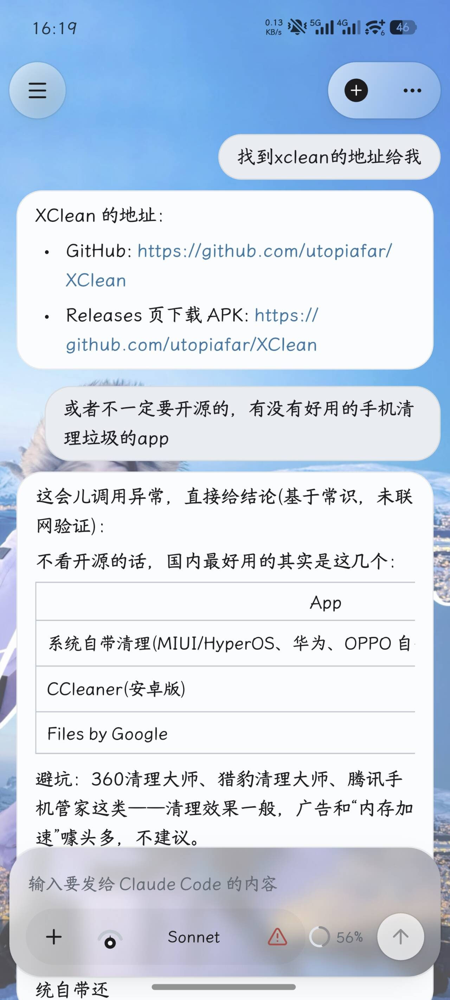
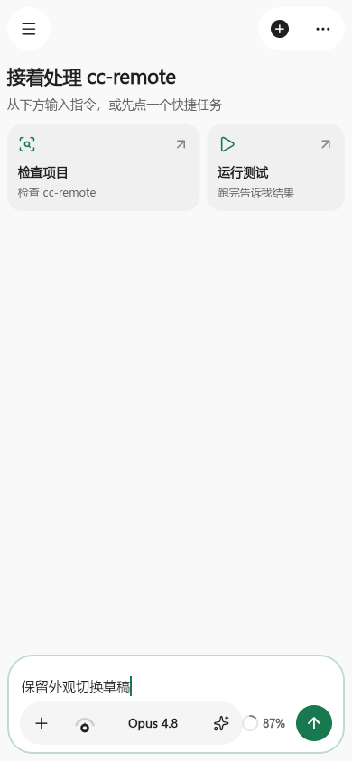
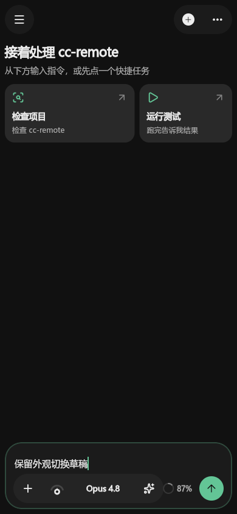
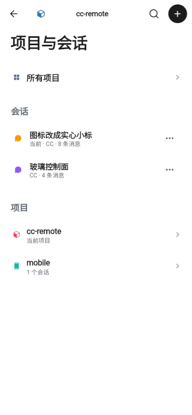
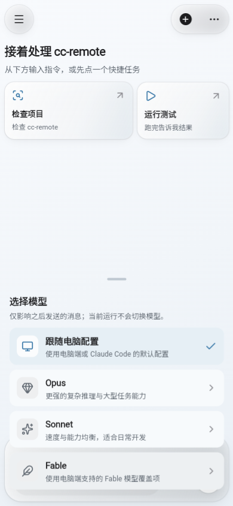
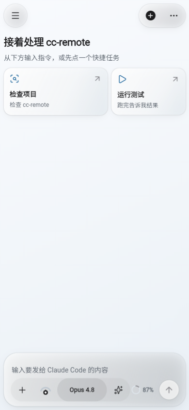
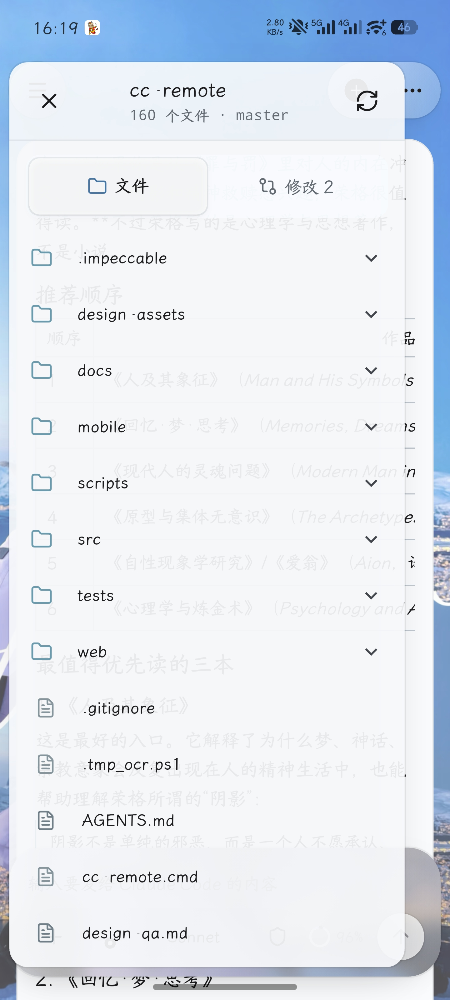
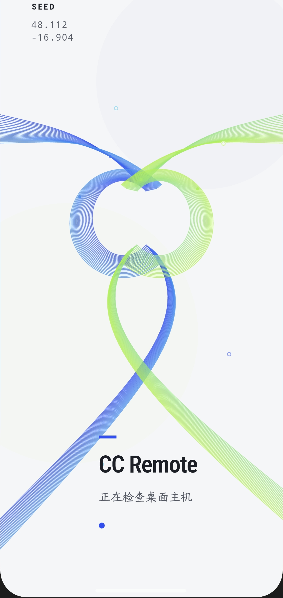

# CC Remote

**在手机上远程控制本机 Claude Code。**

扫码配对后，你就能在手机上发指令、看流式回复、审批工具权限、浏览工作区与 Git 变更。电脑端 daemon 继续运行 Claude Code CLI 或 Codex CLI，手机负责远程控制与阅读。

[下载 Android APK · v2.0.14](https://github.com/TangBo-cpu/cc-remote/releases/download/v2.0.14/cc-remote-v2.0.14-android.apk)
·
[Release 说明](https://github.com/TangBo-cpu/cc-remote/releases/tag/v2.0.14)

```text
手机 App  ──HTTPS / WSS──▶  Cloudflare Tunnel  ──▶  本机 daemon (:8787)  ──▶  Claude Code CLI / Codex CLI
```

<p align="center">
  
</p>

<p align="center"><sub>v1.4.0 历史截图；v2.0.0 使用跟随系统的浅色 / 深色界面</sub></p>

---

## 它能做什么

| 场景 | 体验 |
| --- | --- |
| 出门前丢一条任务 | 手机发 prompt，桌面 Claude 继续跑；流式回复实时回传 |
| 想换引擎 | 新建会话时选 Claude 或 Codex；Codex 支持动态模型目录、原生 `/compact` 与 `/review` 命令、已启用 skills，默认完全访问沙箱 |
| 电脑端免输命令 | Windows 原生启动器选择项目、启动服务、显示配对二维码；关闭窗口后留在托盘 |
| 想换项目目录 | 手机浏览电脑文件夹或输入完整路径，选择 Claude / Codex 后在该目录新建对话；需更新 App 与 daemon |
| 工具要权限 | 手机弹出决策卡：看命令摘要与工作目录，拒绝或仅本次允许 |
| 想确认改了什么 | 只读工作区 + Git diff，手机不提交、不改文件 |
| 断线了 | transcript 与草稿保留，自动重连；回来后从权威快照继续 |
| 字号不合适 | 设置里连续滑杆，默认 100% |
| 外观随环境切换 | 默认跟随系统，也可在设置中固定浅色或深色 |

**安全边界（产品承诺）：**

- daemon 默认只听 `127.0.0.1`，公网走 Tunnel
- 一次性扫码配对，Bearer token；支持多台设备同时配对，手机端可查看设备列表并逐台撤销
- 已配对手机可浏览电脑目录并在所选目录新建会话；工作区文件和 Git diff 接口保持只读，手机不直接执行 shell 或提交文件

---

## 外观预览（开发版）

| 浅色 | 深色 |
| :---: | :---: |
|  |  |

以上是本地 Flutter Web 演示预览。Android 实机的系统字体、系统栏、键盘与手势仍待验收。

## 界面参考（v1.4.0）

| 对话 | 项目与会话 | 选择模型 |
| :---: | :---: | :---: |
|  |  |  |

| 主控制台 | 工作区 | 启动 |
| :---: | :---: | :---: |
|  |  |  |

当前开发版使用中性背景，助手正文直接排在页面上，用户消息保留浅灰气泡；输入区和浮动控件使用中性玻璃材质与柔和阴影。主要操作采用炭黑，深色模式采用近白；选中态使用灰底与字重，正文链接采用中性色和下划线；会话导航保留彩色身份标识与蓝色上下文提示。设置提供「跟随系统 / 浅色 / 深色」，壁纸与背景预设已移除。阅读字号、模型选择、工具折叠、代码复制和权限决策仍保留。以上截图来自 v1.4.0；当前设计规格见 [`DESIGN.md`](DESIGN.md)。

---

## 三分钟上手

### 前提

| 需要 | 说明 |
| --- | --- |
| Node.js 20+ | 跑 daemon（`npm install` / `npm run dev`） |
| Rust MSVC 工具链 + Windows SDK / C++ build tools | 仅构建 Windows 桌面启动器时需要 |
| [Claude Code CLI](https://docs.anthropic.com/en/docs/claude-code) | 本机已能执行 `claude` |
| [Codex CLI](https://developers.openai.com/codex/cli) | 可选；使用 Codex 会话时需包含 `app-server` 命令 |
| [cloudflared](https://developers.cloudflare.com/cloudflare-one/connections/connect-apps/install-and-setup/installation/) | 默认公网隧道；仅本机调试可加 `-NoTunnel` |
| Android 手机 | 安装下方 APK（测试签名） |

当前**没有** npm 全局包：电脑端 = 克隆本仓库 + 本地依赖。`cc-remote` 是仓库根目录的启动脚本，不是 `npm i -g` 装出来的命令。

### 1. 电脑端（首次）

```powershell
git clone https://github.com/TangBo-cpu/cc-remote.git
cd cc-remote
npm install
```

可选：把仓库根目录加入 PATH，之后在任意项目目录都能直接敲 `cc-remote`（Windows 下实际执行的是根目录 `cc-remote.cmd` → `scripts/cc-remote.ps1`）。

### 2. 电脑端（日常）

#### Windows 桌面启动器

在仓库根目录构建一次：

```powershell
npm run build:desktop
```

双击根目录的 `cc-remote-desktop.exe`，选择项目文件夹，点击「启动服务」。手机可直接扫描窗口中的二维码。再次打开时，启动器会恢复已保存且仍存在的项目文件夹，并自动启动服务。

请把 EXE 留在仓库目录内；日常使用可以创建指向它的桌面快捷方式。启动器复用已安装的 Node.js、cloudflared、Claude Code 和 Codex CLI。它使用 Rust + Win32 原生控件，运行时无需 WebView。

关闭窗口后，服务继续运行，启动器留在系统托盘。点击「停止服务」或「退出」只停止该启动器启动的服务与隧道；连接现有 daemon 时，退出会保留该 daemon。活动任务需要确认后才能停止。

固定隧道可复用 `.run/cloudflared-cc-remote.yml`，启动器托管的隧道异常退出后会自动退避重试，保留 daemon 和正在执行的任务。临时隧道退出后不会自动重启，重新启动后地址若变化，手机需重新配对。「本机模式」跳过隧道，默认回环地址需要端口转发才能供手机访问。构建、配对与故障处理见 [`desktop/README.md`](desktop/README.md)。

#### 命令行启动

在**要交给 Claude 的项目目录**启动（工作区默认 = 当前目录）：

```powershell
# PATH 已包含本仓库根目录时：
cc-remote

# 或未改 PATH，从任意目录显式调用：
& C:\path\to\cc-remote\cc-remote.cmd

# 或在仓库根指定工作区：
npm run cc-remote -- -WorkspaceDir "C:\path\to\your-project"
```

会启动 daemon + Cloudflare Tunnel，并在终端打印**手机配对二维码**。`Ctrl+C` 结束本次服务（隧道一并停）。

- daemon **已在跑**时，换到另一项目目录再执行一次，只注册并切换工作区，不重复起服务。
- 仅本机联调、不要隧道：`cc-remote -NoTunnel`（手机需能访问你的电脑，或自行做端口转发）。
- 固定隧道域名：配置 `.run/cloudflared-cc-remote.yml`，或设环境变量 / 传参 `-PublicOrigin https://your-host.example.com`。

### 3. 手机端

1. 安装 [v2.0.14 APK](https://github.com/TangBo-cpu/cc-remote/releases/download/v2.0.14/cc-remote-v2.0.14-android.apk)（测试签名，个人使用；覆盖更新时不要卸载旧版）
2. 允许「未知来源」安装
3. 打开 App → 扫启动器窗口或终端中的二维码 → 确认电脑名与服务地址 → 进入控制台

Android App 版本为 v2.0.13。本版加入多设备授权与平板双栏布局，需要同时更新电脑端代码并重启 daemon；旧配对与新配对的手机都保留授权，手机端可直接覆盖安装，保留已有配对与设置。

### 4. 开始对话

在 Composer 输入任务，或点空状态快捷芯片。要切换目录，打开聊天页顶部「项目与会话」→「打开电脑目录」，浏览或输入电脑目录，选择 Claude Code / Codex 后新建对话。旧对话保留原目录和历史，输入框草稿保留。任务运行期间可浏览目录，创建和切换需等待任务与附件操作结束。

---

## 功能清单

**连接与会话**

- Windows 原生启动器：项目选择、二维码配对、连接与任务状态、启动日志、托盘常驻
- 扫码配对 / Secure Storage / 启动恢复；多设备授权（默认上限 8 台），手机端设备列表与逐台撤销
- WebSocket 鉴权、退避重连、前台存活探测与活动任务状态恢复
- 多项目、多会话；完整项目路径展示
- 平板适配：≥840dp 宽时会话列表常驻左侧双栏，弹层与输入框居中限宽
- 会话级引擎切换：Claude Code 或 Codex CLI（新建会话时选择）
- 会话 transcript 持久化与恢复
- 跨项目会话全文搜索、匹配片段高亮与命中消息精确跳转

**对话与控制**

- 流式输出（合批推送；无标记走 Text，有 Markdown 标记时流式期间即渲染）
- Claude Streaming Input 与 Codex App Server 常驻复用，后续轮次不重复启动 CLI
- 助手 Markdown 中的搜索来源 / 引用链接可点击，仅允许 `http` / `https` 并交给系统浏览器打开
- 停止任务、花形思考状态与本轮运行计时、安全化工具活动
- Composer 思考强度仪表与六档思考强度（自动 + 低、中、高、超高、最大五手动档）
- 斜杠指令与技能：Claude Code 原生指令；Codex 会话按需获取原生指令（`/compact` 压缩上下文、`/review` 代码审查）以及当前项目已启用的 skills
- 模型选择：Composer 模型按钮呼出共用抽屉；Claude 支持静态模型档位，Codex 支持动态获取电脑端模型目录并独立持久化偏好，支持恢复电脑默认
- 六种权限模式 + 一次性工具审批（Claude 会话）
- Codex 沙箱模式三档（read-only / workspace-write / danger-full-access），默认完全访问（danger-full-access）且持续生效，可随时显式切为只读或工作区可写
- 图片 / 文件附件（每轮最多 5 个，单文件 ≤ 25MB；Codex 会话仅支持图片）
- 回复中的本地图片链接自动登记为会话附件，手机鉴权下载并在对应回复下方完整展示；支持 PNG、JPEG、WebP 和 GIF，文件须位于当前项目或本会话附件目录

**工作区（只读）**

- 浏览已注册项目文件
- 查看 Git diff（含未跟踪摘要）

**通知与偏好**

- Android 后台本地通知（完成 / 失败 / 等待权限）
- 连续字号滑杆（约 0.85×–1.40×，默认 1.0）
- 外观：跟随系统 / 浅色 / 深色，选择本地持久化

**当前不做 / 限制**

- 无 FCM（进程被杀后无法推送）
- 工作区不可编辑、暂存、提交
- APK 为测试签名，非应用商店包

---

## 开发者

### 校验

```powershell
npm run typecheck
npm run build
npm test
cd mobile
flutter analyze
flutter test
```

Windows 启动器的 Rust 测试、Clippy 和原生窗口检查见 [`desktop/README.md`](desktop/README.md#校验)。

### 手动跑 daemon

```powershell
npm install
$env:PUBLIC_ORIGIN = "https://your-tunnel.example.com"
$env:WORKSPACE_DIR = "C:\path\to\project"
$env:DEVICE_NAME = "My PC"
npm run dev
```

不设 `PUBLIC_ORIGIN` 时默认 `http://127.0.0.1:8787`（本机调试）。

### Flutter

```powershell
cd mobile
flutter pub get
flutter run
# 或
flutter build apk --release --obfuscate --split-debug-info=build/symbols
```

### 常用启动参数

```powershell
cc-remote -NoTunnel
cc-remote -WorkspaceDir "C:\Projects\app" -DeviceName "My PC"
cc-remote -DisableBypassPermissions
```

### 配置（摘要）

| 变量 | 默认 | 说明 |
| --- | --- | --- |
| `HOST` / `PORT` | `127.0.0.1` / `8787` | 本机监听 |
| `PUBLIC_ORIGIN` | `http://127.0.0.1:8787` | 手机访问源 |
| `WORKSPACE_DIR` | 当前目录 | 启动时注册并激活的项目 |
| `DEVICE_NAME` | 主机名 | 配对显示名 |
| `ALLOW_BYPASS_PERMISSIONS` | `1` | 是否允许手机选「跳过权限」 |
| `CLAUDE_BIN` | `claude` | Claude CLI 路径 |
| `CODEX_BIN` / `CODEX_ARGS` | PATH 中的 `codex` | Codex CLI 路径与附加参数（`|` 分隔） |
| `MAX_PAIRED_DEVICES` | `8` | 可同时配对的手机数量上限；合法范围 `1–16`，非法值回退默认值 |
| `MAX_WS_CONNECTIONS` | `16` | WebSocket 同时连接上限；合法范围 `1–64`，非法值回退默认值 |
| `WS_AUTH_TIMEOUT_MS` | `10000` | WebSocket 鉴权超时（毫秒）；合法范围 `1000–60000`，非法值回退默认值 |
| `WS_HEARTBEAT_INTERVAL_MS` | `30000` | WebSocket heartbeat 间隔（毫秒）；合法范围 `1000–120000`，非法值回退默认值 |
| `WS_CLOSE_TIMEOUT_MS` | `1000` | 授权变化后的关闭兜底超时（毫秒）；合法范围 `100–10000`，非法值回退默认值 |

### 协议与 API

- 配对：启动器或终端中的一次性 JSON 二维码（5 分钟、单次）→ `POST /api/pair`（可携带手机 `deviceName`）→ 每台设备获得独立 token 与 `deviceId`，token 仅返回一次；新配对不影响已配对设备，加新设备需刷新二维码
- 实时：`/ws` 首条必须 `{ "type": "auth", "token": "..." }`，之后 `prompt` / `stop` / `permission_response` 等；prompt 可带 `engine`（须与会话引擎一致），Codex 会话另带 `sandboxMode`
- 多设备：`GET /api/devices` 返回设备列表（含本机标记与最近活跃时间）；`POST /api/devices/{id}/revoke` 撤销单台设备并立即断开其连接；设备列表变化时 daemon 向所有已认证连接广播 `{ "type": "devices", ... }`；`POST /api/logout` 仅撤销调用方自己的设备
- 存活探测：daemon 在 `status` 中声明 `connectionProbe: true` 与 `multiDevice: true` 能力位后，App 按能力降级；探测为 `{ "type": "ping", "probeId": "..." }` 并等待同 ID 的 `pong`，默认 8 秒超时后进入重连，旧服务端未声明能力时不发送探测。恢复前台时保留现有连接，用 8 秒探测窗口确认存活，不因隧道延迟误断健康连接；探测失败立即重连，无连接时跳过退避立即重试，已经开始的握手继续完成
- HTTP：健康检查无需鉴权；项目、会话、附件、工作区、设备列表等需 Bearer；`GET /api/models?sessionId=...` 按需拉取 Codex 动态模型目录；`GET /api/commands?sessionId=...` 拉取当前会话命令与技能目录
- 本地控制：`GET /api/local/status`、`POST /api/local/pairing`、`POST /api/local/shutdown` 和 `POST /api/local/projects/register` 使用本机控制 token，校验回环来源、Host 和 Origin，不接受手机 Bearer token

完整消息类型、HTTP 路由与状态机说明见：

- [`docs/mobile-app-architecture.md`](docs/mobile-app-architecture.md)
- [`docs/flutter-app-design.md`](docs/flutter-app-design.md)
- [`docs/mobile-ui-app-design.md`](docs/mobile-ui-app-design.md)
- [`mobile/README.md`](mobile/README.md)
- [`desktop/README.md`](desktop/README.md)

### 重置配对

使用 Windows 启动器时，点击「重新配对」并用手机扫描新二维码。显示新二维码不会撤销已配对设备的 token；新设备配对成功后，旧设备继续可用。二维码过期时也可重新生成。要下线某台手机，在该手机的「设置 → 已配对设备」中撤销，或由任意已配对设备在设备列表中撤销它。

命令行重置也可停止 daemon，删除 `.data/state.json`，再启动并重新扫码。

---

## 版本

当前公开版：**[v2.0.14](https://github.com/TangBo-cpu/cc-remote/releases/tag/v2.0.14)**
APK：[`cc-remote-v2.0.14-android.apk`](https://github.com/TangBo-cpu/cc-remote/releases/download/v2.0.14/cc-remote-v2.0.14-android.apk)

v2.0.14 优化流式对话：合并聊天快照写入，降低 Markdown 重解析频率，并在尾部文字更新时复用已有历史消息。平板会话侧栏固定宽度，保留收起与展开；顶部模糊范围进一步缩小。桌面端在配对成功和重启后继续显示二维码，方便添加其他设备。Android 版本为 `2.0.14+24`，电脑端 package 版本为 `2.0.14`，安装包沿用旧版测试签名，适合个人使用。
